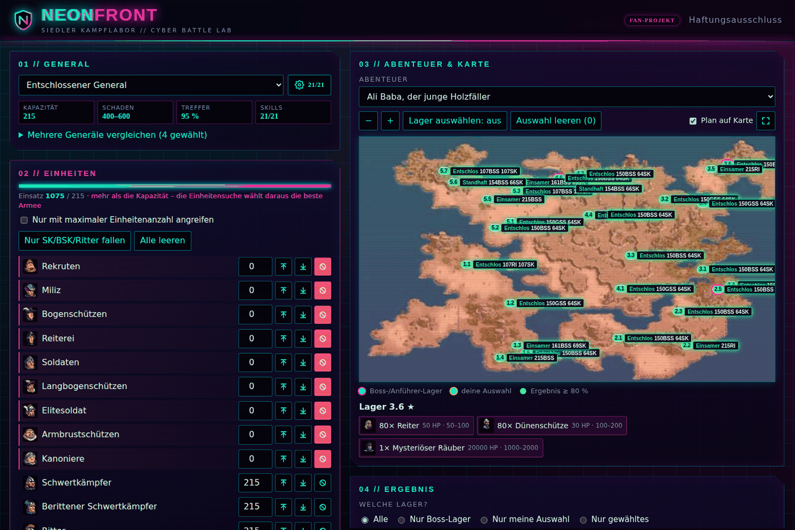
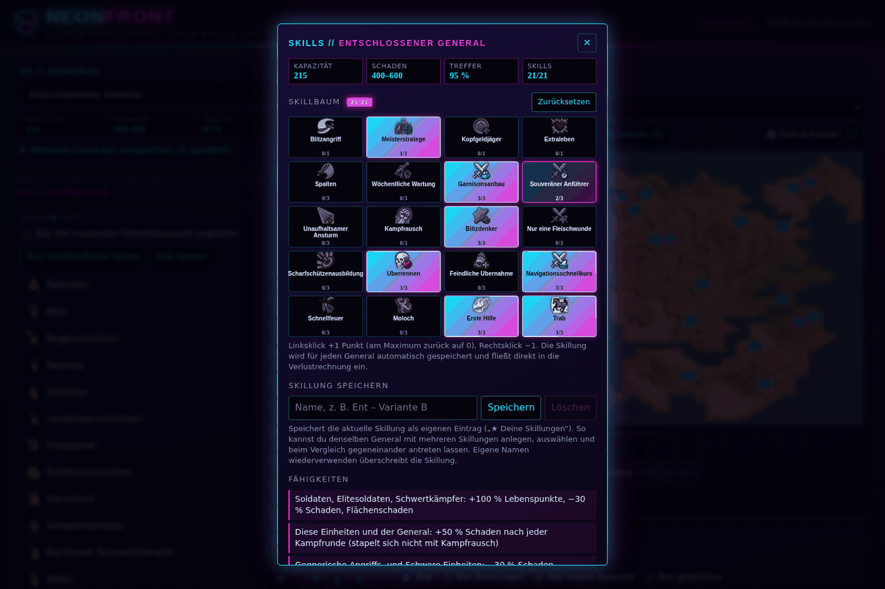
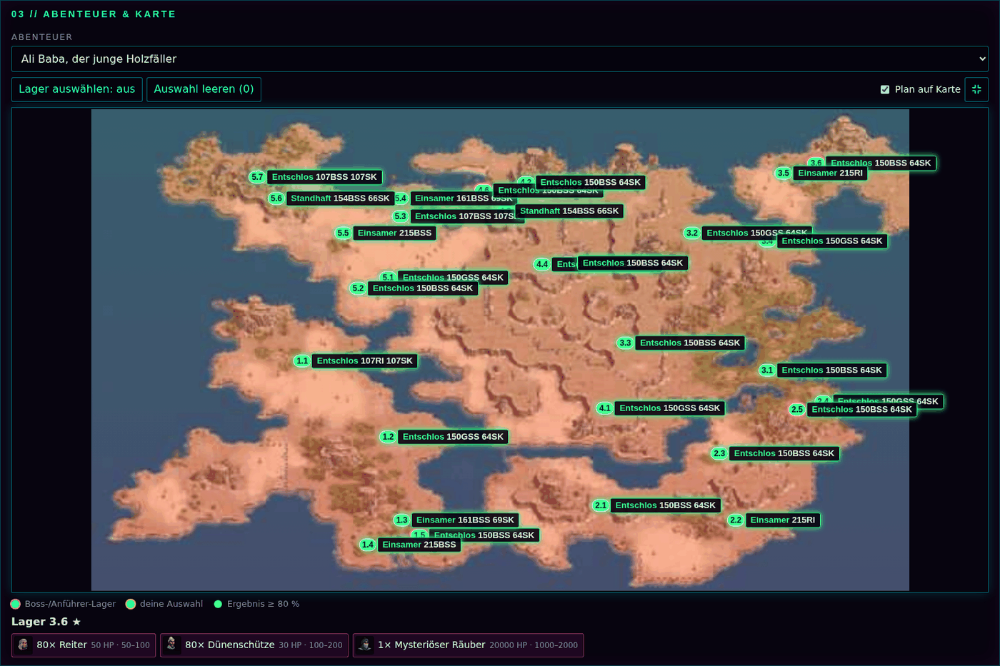

<div align="center">

# NEON**FRONT**
### Siedler Kampflabor // Cyber Battle Lab

Inoffizieller Kampfsimulator für **Die Siedler Online** im Neon-/Cyberpunk-Look –
Abenteuer simulieren, Generäle skillen und die beste Armee pro Lager finden.




</div>

---

## Was ist NEONFRONT?

NEONFRONT berechnet per Zufallssimulation (Monte-Carlo), wie sich eine Armee gegen die Lager eines Abenteuers schlägt – inklusive Verlusten, Siegchancen und der Frage, **welcher General mit welchen Truppen** ein Lager am günstigsten schafft. Alles läuft komplett im Browser, es gibt keinen Server, kein Konto und kein Tracking.

> Das Projekt ist eine eigene Neon-Variante, inspiriert vom TSO Swift Simulator und dem TSO Wiki Simulator.

## Funktionen

- **Generäle automatisch richtig** – Werte, Initiative (Erst-/Letzter Schlag), Flankieren, Flächenschaden und die Spezialfähigkeiten jedes Generals werden automatisch erkannt und fest in die Simulation eingerechnet. Einstellen musst du nur die Skillpunkte.
- **Skill-Dialog mit Original-Icons** – kompakter Skillbaum (21 Punkte) hinter dem Zahnrad. Die Skillung wird pro General automatisch gespeichert.
- **Benannte Skillungen** – denselben General mehrfach mit verschiedenen Skillungen speichern, auswählen und gegeneinander vergleichen.
- **Einheiten-Verwaltung wie im Wiki-Simulator** – Pfeil hoch füllt auf die volle Kapazität, Pfeil runter leert, der durchgestrichene Kreis schützt eine Einheit vor Verlusten. „Nur SK/BSK/Ritter fallen“ schützt alle anderen mit einem Klick.
- **Einheitensuche** – wählt für jedes Lager aus deinen Truppen die beste Armee (bei Bedarf als mehrere Angriffe hintereinander) und vergleicht dabei mehrere Generäle.
- **Plan auf der Karte** – nach der Simulation steht an jedem Lager, welcher General mit welchen Einheiten angreift, dazu eine Zusammenfassung mit Truppen gesamt, Verlusten und Generälen.
- **Vollbild-Karte** – die ganze Karte auf einen Klick einpassen, mit ausführlichen Angriffsplänen (Esc oder Symbol zum Verkleinern).
- **Eigene Lager-Auswahl** – goldener Ring für deine Auswahl, getrennt von den rosa markierten Boss-Lagern.

## Screenshots

| Skill-Dialog | Plan im Vollbild |
|:---:|:---:|
|  |  |

> Die Screenshots entstanden ohne die Google-Schriften, daher weichen Überschriften leicht vom Original ab.

## Schnellstart

Es ist kein Build-System nötig.

```bash
git clone <dein-repo>
cd neonfront
# einfach index.html im Browser öffnen – oder lokal servieren:
python3 -m http.server 8080
```

Für GitHub Pages: *Settings → Pages → Branch `main`, Ordner `/ (root)`*.

## Bedienung in 4 Schritten

1. **General wählen** und über das Zahnrad die Skillpunkte verteilen.
2. **Einheiten eintragen** – oder per Pfeil auf die volle Kapazität auffüllen; wichtige Einheiten mit dem Kreis schützen.
3. **Abenteuer und Lager wählen** – alle, nur Boss-Lager, nur deine Auswahl oder ein einzelnes Lager.
4. **Simulieren** oder **Einheitensuche** starten und den Plan auf der Karte ansehen.

## Projektstruktur

```
index.html        Markup (Header, Karten, Dialoge, Footer)
css/style.css     gesamtes Styling
js/data.js        Spieldaten (Einheiten, Generäle, Karten, Icons) – große Datei
js/core.js        Hilfsfunktionen, Konstanten, Einheiten-Kürzel
js/abilities.js   Fähigkeiten der Generäle (Quelle: tsowiki.eu/specialists/generals)
js/icons.js       Original-Skill-Icons (Base64)
js/skills.js      Skillbaum
js/generals.js    Generäle, gespeicherte Skillungen
js/units.js       Einheiten-Liste, Kapazität, Kurzübersicht
js/map.js         Abenteuerkarte, Lager, Markierungen, Plan-Labels
js/sim.js         Kampfmodell, Einheitensuche
js/results.js     Simulation starten, Ergebnistabelle
js/main.js        Event-Verdrahtung, Dialoge, Vollbild, Start
docs/             Screenshots für dieses README
```

Die Skripte werden der Reihe nach geladen (siehe `index.html`). Es werden bewusst keine ES-Module verwendet, damit die Seite auch direkt per Doppelklick (`file://`) funktioniert.

## Einen General ergänzen oder korrigieren

Die Grundwerte stehen in `js/data.js` (`D.g`). Besondere Fähigkeiten werden in `js/abilities.js` beschrieben:

```js
BorisGeneral:{
  enemyDmg:[{cat:'sw',v:-50}],            // gegnerische Schnelle: -50 % Schaden
  desc:['Schnelle Einheiten: +50 % Schaden','Gegnerische Schnelle Einheiten: −50 % Schaden']
}
```

Mögliche Bausteine: `units` (Bonus/Malus für eigene Einheiten: `hp`, `dmg`, `acc`, `flat`, `splash`, `flank`, `rounds`), `enemyDmg`, `enemyHp`, `noFlank`, `genRounds`, `t` (einfache Werte überschreiben). Details stehen im Kommentar am Anfang der Datei.

## Hinweise zur Genauigkeit

- Die Simulation ist ein **angenähertes** Kampfmodell mit Zufallsläufen. Ergebnisse können vom Spiel abweichen.
- Die Einteilung gegnerischer Einheiten in „Schnelle“, „Angriffs-“, „Schwere“ und „Verteidigungseinheiten“ erfolgt anhand ihrer Namen.
- Nicht eingerechnet sind Erfahrungs- und Beute-Boni sowie „Erholt sich sofort nach der ersten Niederlage“.

## Datenquellen

- Generäle und Fähigkeiten: [tsowiki.eu](https://tsowiki.eu/specialists/generals/)
- Skillwerte: Entwickler-Angaben (Dev Diary 2017)
- Spieldaten und Grafiken stammen aus *Die Siedler Online*.

## Rechtliches

NEONFRONT ist ein **inoffizielles Fan-Projekt** ohne Gewinnerzielungsabsicht und steht in keiner Verbindung zu Ubisoft oder Blue Byte. *Die Siedler Online* und zugehörige Namen, Daten und Grafiken gehören den jeweiligen Rechteinhabern.

**Haftungsausschluss:** Für simulierte Kampfergebnisse wird keine Verantwortung übernommen – Nutzung auf eigene Gefahr.

Vor dem Veröffentlichen:

- Impressum und Datenschutzerklärung in `index.html` (Dialog `#legal`): gelbe Platzhalter `[…]` durch echte Angaben ersetzen.
- Optional die Google Fonts lokal einbinden (Datenschutz).
- Eine Lizenz für den Code festlegen (noch nicht gewählt).
